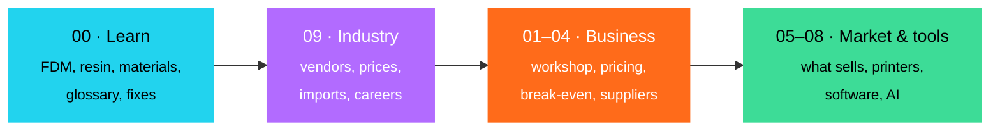
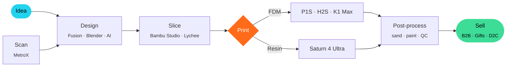
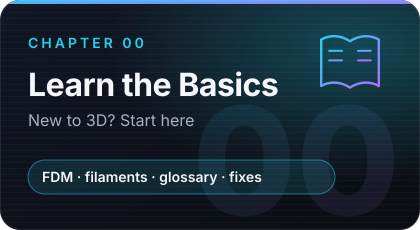
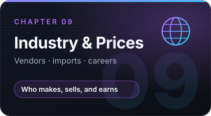
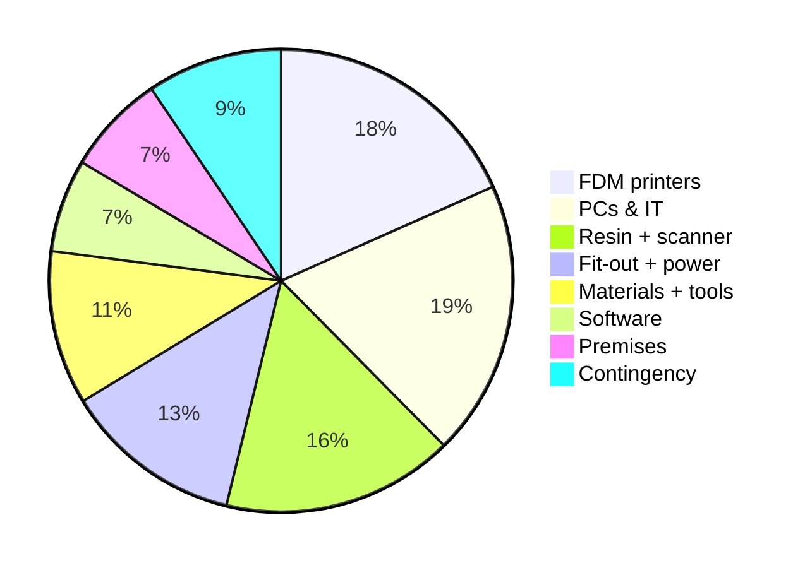
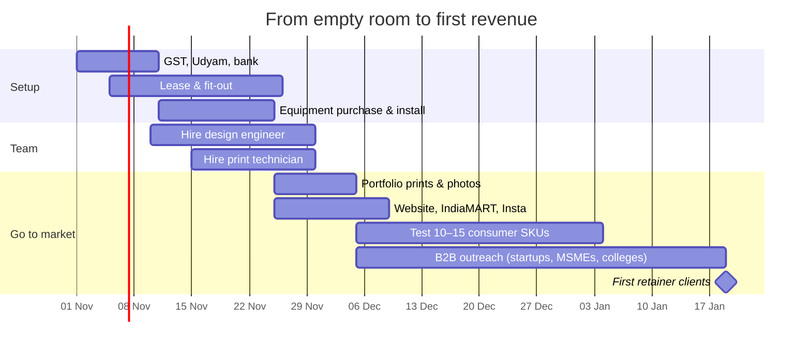

<p align="center">
  
</p>

<p align="center">
  
  
  
  
</p>

<p align="center">
  <b>Learn the 3D printing industry — layer by layer.</b><br/>
  How the technology works, materials, who makes and sells what, what things cost in India,<br/>
  and the business behind it — with a ₹20L Bangalore workshop as a worked example.
</p>

<p align="center">
  <a href="https://srikumar1987.github.io/3D/"><b>Open the interactive site →</b></a>
  &nbsp;·&nbsp;
  <a href="guide/00-learn-basics.md">Learn the basics</a>
  &nbsp;·&nbsp;
  <a href="guide/09-industry.md">Industry & prices</a>
  &nbsp;·&nbsp;
  <a href="#chapters">Chapters</a>
  &nbsp;·&nbsp;
  <a href="#at-a-glance">At a glance</a>
</p>

<p align="center"></p>

## How to use this guide



## The journey of a print



<a id="chapters"></a>

## Chapters

<table>
  <tr>
    <td><a href="guide/00-learn-basics.md"></a></td>
    <td><a href="guide/09-industry.md"></a></td>
  </tr>
  <tr>
    <td><a href="guide/01-workshop-setup.md"></a></td>
    <td><a href="guide/02-pricing-model.md"></a></td>
  </tr>
  <tr>
    <td><a href="guide/03-break-even.md"></a></td>
    <td><a href="guide/04-suppliers.md"></a></td>
  </tr>
  <tr>
    <td><a href="guide/05-filaments-and-products.md"></a></td>
    <td><a href="guide/06-slippers.md"></a></td>
  </tr>
  <tr>
    <td><a href="guide/07-printers-and-waste.md"></a></td>
    <td><a href="guide/08-software-and-ai.md"></a></td>
  </tr>
</table>

<p align="center"></p>

<a id="at-a-glance"></a>

## At a glance

### Printer prices in India (Oct 2026, incl. GST)

| Printer | Type | Price | Good for |
|---|---|--:|---|
| Bambu Lab A1 Mini | FDM | ₹21,499 | First printer, students |
| Bambu Lab A1 | FDM | ₹31,999 | Best-value beginner |
| Bambu Lab P1S Combo | FDM, enclosed, multi-colour | ₹69,999 | Small-business workhorse |
| Bambu Lab P2S Combo | FDM, enclosed, multi-colour | ₹1,02,999 | Newer P1S replacement |
| Bambu Lab H2S | FDM, heated chamber | ₹1,54,999 | Engineering materials |
| Bambu Lab H2D | FDM, dual nozzle | from ₹2,19,999 | Multi-material, low waste |
| Creality K1 Max | FDM, 300 mm | ₹71,999 | Large parts |
| Elegoo Saturn 4 Ultra 16K | Resin | ₹59,999–61,499 | Miniatures, jewellery |
| Prusa CORE One | FDM, enclosed | ₹1.70–2.10L | Open-source, repairable |
| Formlabs Form 4 | Professional resin | ~₹6.25L + GST | Dental, industrial |

More in **[09 · Industry](guide/09-industry.md)** — vendors, filament brands, import costs, careers.

<table>
<tr>
<td width="50%" valign="top">

### Worked example — where ₹20L goes



</td>
<td width="50%" valign="top">

### Key numbers

| Metric | Value |
|---|--:|
| Machines | **4 FDM · 3 resin · 1 scanner** |
| Space | **~600 sq ft** |
| Team | **3 + founder** |
| Monthly burn | **~₹1.6L** |
| Cash break-even | **~₹2.3L / month** |
| Capacity | **~₹5.3L / month** |
| Cash-positive (cumulative) | **~Month 8** |
| Full payback | **20–24 months** |

</td>
</tr>
</table>

### Is importing filament from China worth it?

| | Personal parcel | Commercial import (100 kg, air) | Commercial import (500 kg+, sea) |
|---|---|---|---|
| Duty | ~77% (not claimable) | ~12.1% + 18% IGST (claimable) | ~12.1% + 18% IGST (claimable) |
| Landed PLA (est.) | — | ~₹1,270–1,420 / kg | ~₹940–970 / kg |
| vs buying in India | Much worse | **Worse** | **About equal**, with more risk |

> Buy Chinese brands (eSUN, SUNLU, Elegoo, Polymaker) from Indian distributors, plus Indian makers (Numakers, FibReel, Vektor3D) for value PLA. Try the **import calculator** on the site.

<details>
<summary><b>Quote formula (click to expand)</b></summary>

```
Price = (Material × rate) + (Print hours × machine rate) + (Labour hours × labour rate)
      + Design/scan fee
      × 1.10 failure buffer × rush multiplier
      → minimum ₹500, then add 18% GST
```

| FDM std | FDM eng | Resin | Technician | Finishing | CAD | Rush |
|:-:|:-:|:-:|:-:|:-:|:-:|:-:|
| ₹60/h | ₹90/h | ₹80/h | ₹400/h | ₹500/h | ₹1,000–1,500/h | +40% |

</details>

<details>
<summary><b>Best starter kit (click to expand)</b></summary>

| Item | Why | ~Cost |
|---|---|--:|
| Bambu Lab P1S Combo | Reliable, multi-colour, TPU-capable | ₹69,999 |
| Elegoo Saturn 4 Ultra 16K + wash/cure | Jewellery, figurines, fine detail | ~₹80,000 |
| Tinkercad → Fusion + Blender | Learn → function → art | Free to start |

</details>

<p align="center"></p>

## Worked example — 90-day launch



## Repository map

```
3D/
├── README.md                 ← you are here
├── guide/                    ← 00 Learn · 01–08 business & market · 09 Industry
├── docs/                     ← interactive website (GitHub Pages)
│   ├── index.html
│   ├── styles.css
│   ├── learn.js              ← Learn section (explorer, glossary, quizzes)
│   ├── industry.js           ← Industry section (directories, import calculator)
│   └── app.js                ← workshop, pricing, break-even, market
├── assets/                   ← hero, divider, chapter cards (SVG)
└── tools/gen_cards.py        ← regenerates chapter cards
```

> [!NOTE]
> Prices are indicative (India, Oct 2026, incl. GST unless stated) from public reseller listings and change often. Market tiers, margins and salary ranges are estimates for learning — verify before making decisions. Supplier contacts come from public websites; confirm on written quotes.

<p align="center">
  <br/>
  <sub>Built layer by layer · Bengaluru</sub>
</p>
