<p align="center">
  
</p>

<p align="center">
  
  
  
  
</p>

<p align="center">
  <b>A visual field guide to the 3D printing industry</b> — what to buy, what to charge,<br/>
  what sells, who to buy from, and how AI fits in. Written for a Bangalore-based workshop.
</p>

<p align="center">
  <a href="https://srikumar1987.github.io/3D/"><b>Open the interactive site →</b></a>
  &nbsp;·&nbsp;
  <a href="#chapters">Chapters</a>
  &nbsp;·&nbsp;
  <a href="#at-a-glance">At a glance</a>
  &nbsp;·&nbsp;
  <a href="#90-day-launch">90-day launch</a>
</p>

<p align="center"></p>

## The journey

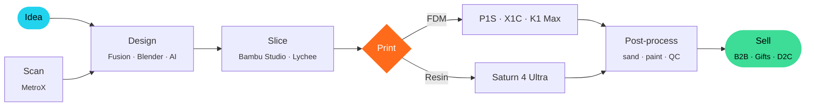

<a id="chapters"></a>

## Chapters

<table>
  <tr>
    <td><a href="guide/01-workshop-setup.md">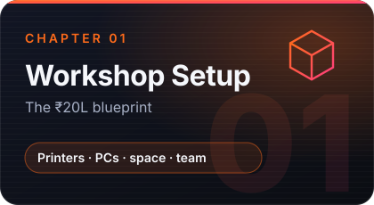</a></td>
    <td><a href="guide/02-pricing-model.md">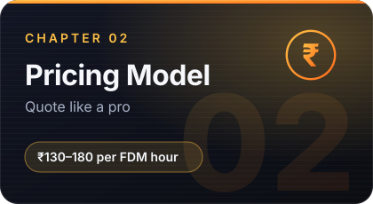</a></td>
  </tr>
  <tr>
    <td><a href="guide/03-break-even.md">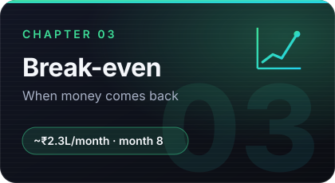</a></td>
    <td><a href="guide/04-suppliers.md">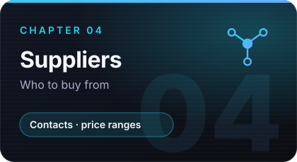</a></td>
  </tr>
  <tr>
    <td><a href="guide/05-filaments-and-products.md">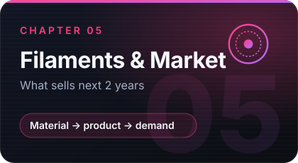</a></td>
    <td><a href="guide/06-slippers.md">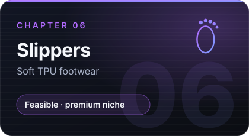</a></td>
  </tr>
  <tr>
    <td><a href="guide/07-printers-and-waste.md">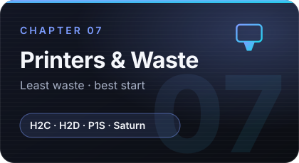</a></td>
    <td><a href="guide/08-software-and-ai.md">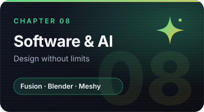</a></td>
  </tr>
</table>

<p align="center"></p>

<a id="at-a-glance"></a>

## At a glance

<table>
<tr>
<td width="50%" valign="top">

### Where the ₹20L goes

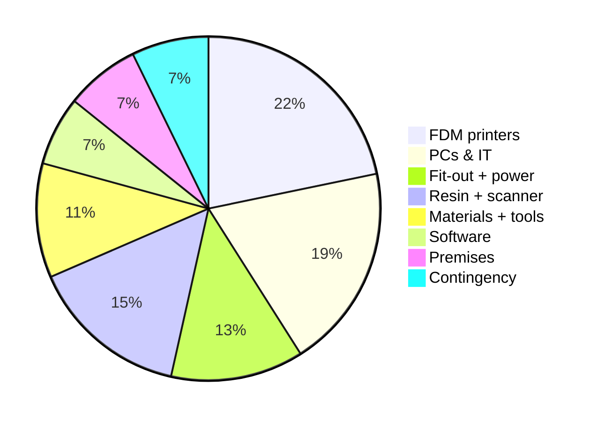

</td>
<td width="50%" valign="top">

### Key numbers

| Metric | Value |
|---|--:|
| Machines | **4 FDM · 3 resin · 1 scanner** |
| Space | **~600 sq ft** |
| Team | **3 + founder** |
| Monthly burn | **~₹1.6L** |
| Cash break-even | **~₹2.3L / month** |
| Capacity | **~₹5.3L / month** |
| Cash-positive (cumulative) | **~Month 8** |
| Full payback | **20–24 months** |

</td>
</tr>
</table>

### What will sell (next 2 years)

| | Tier 1 — focus | Tier 2 — add-ons | Tier 3 — niche / risky |
|---|---|---|---|
| **Products** | Corporate gifting · personalised gifts · B2B prototyping & jigs · jewellery masters · fashion earrings | Original toys · painted miniatures · home décor · cosplay · festival items | Slippers · phone cases · licensed characters |
| **Material** | PLA · PETG · castable resin | PLA multi-colour · ABS-like resin | TPU 85A · TPU 95A |

<details>
<summary><b>Quote formula (click to expand)</b></summary>

```
Price = (Material × rate) + (Print hours × machine rate) + (Labour hours × labour rate)
      + Design/scan fee
      × 1.10 failure buffer × rush multiplier
      → minimum ₹500, then add 18% GST
```

| FDM std | FDM eng | Resin | Technician | Finishing | CAD | Rush |
|:-:|:-:|:-:|:-:|:-:|:-:|:-:|
| ₹60/h | ₹90/h | ₹80/h | ₹400/h | ₹500/h | ₹1,000–1,500/h | +40% |

</details>

<details>
<summary><b>Best starter kit (click to expand)</b></summary>

| Item | Why | ~Cost |
|---|---|--:|
| Bambu Lab P1S / P2S Combo | Reliable, multi-colour, TPU-capable | ₹0.95L |
| Elegoo Saturn 4 Ultra 16K + wash/cure | Jewellery, figurines, fine detail | ₹0.7L |
| Tinkercad → Fusion + Blender | Learn → function → art | Free to start |
| Meshy (AI) | Photo → figurine | Paid plan for commercial use |

</details>

<p align="center"></p>

<a id="90-day-launch"></a>

## 90-day launch

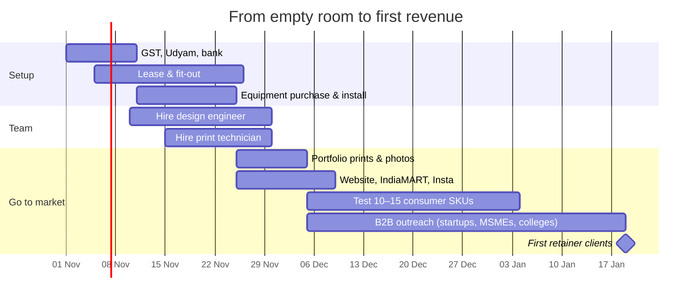

## Repository map

```
3D/
├── README.md                 ← you are here
├── guide/                    ← 8 deep-dive chapters
├── docs/                     ← interactive website (GitHub Pages)
│   ├── index.html
│   ├── styles.css
│   └── app.js
├── assets/                   ← hero, divider, chapter cards (SVG)
└── tools/gen_cards.py        ← regenerates chapter cards
```

> [!NOTE]
> Prices are indicative (India, Oct 2026, incl. GST) and change often. Market tiers are professional judgement — validate with test listings before scaling. Supplier contacts come from public websites; confirm on written quotes.

<p align="center">
  <br/>
  <sub>Built layer by layer · Bengaluru</sub>
</p>
