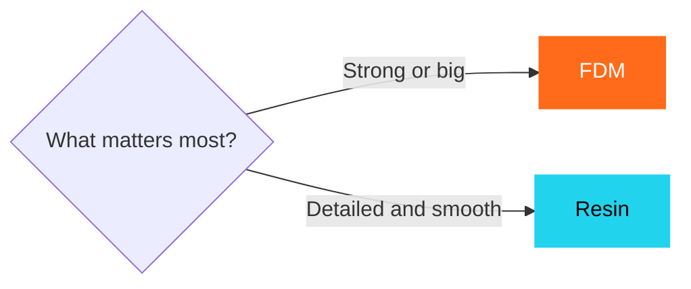
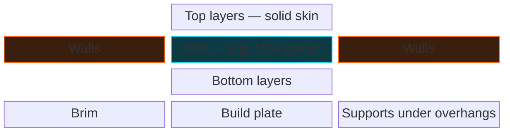
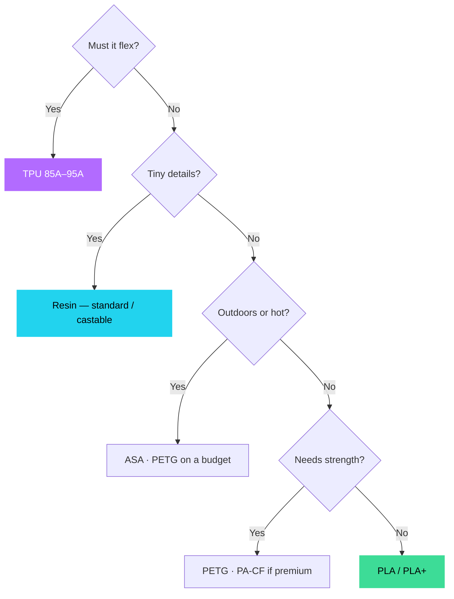
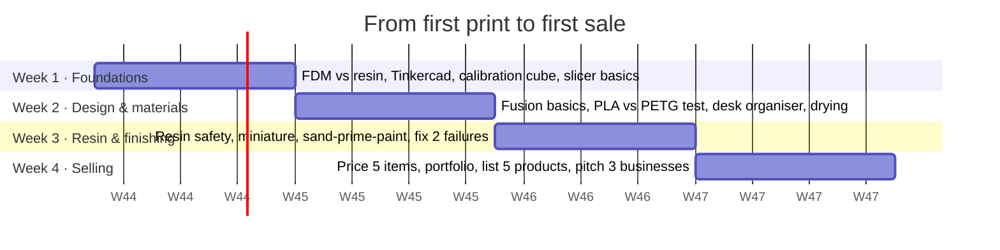

# 00 · Learn the Basics

> New to 3D printing? Start here. FDM vs resin, every filament, the words you'll hear, how a print is made, fixes for common failures, and the dos & don'ts of the trade.

[Index](../README.md) · [Next: Workshop setup →](01-workshop-setup.md)

> [!TIP]
> The **interactive version** (filament explorer, material quiz, searchable glossary, safety checklist, 30-day tracker, self-test) lives on the website → **Learn**.

---

## 1 · The two technologies

| | **FDM** — Fused Deposition Modelling | **Resin** — SLA / MSLA / DLP |
|---|---|---|
| **How it works** | Plastic wire (filament) is melted in a hot nozzle and drawn line by line, layer by layer | Liquid resin is hardened layer by layer with UV light; the part grows upside-down |
| **Machines** | Bambu P1S, X1C, H2D · Creality K1 Max | Elegoo Saturn 4 Ultra · Formlabs Form 4 |
| **Finish** | Visible layer lines | Very smooth, fine detail |
| **Strength** | Strong & functional | More brittle (unless tough resins) |
| **Size** | Medium–large | Small–medium |
| **Running cost** | Low — ₹1–4 / g | Higher — ₹3–20 / ml |
| **Safety** | Clean, low risk | Gloves, ventilation, IPA washing |
| **Best for** | Brackets, organisers, toys, prototypes | Jewellery, miniatures, dental, figurines |

Industrial cousins: **SLS / MJF** (nylon powder, laser-fused) and **DMLS / SLM** (metal powder).

## 2 · Anatomy of an FDM print

- **Walls** carry most of the load — add walls before infill.
- **Infill** saves material and time.
- **Layer height** 0.1–0.3 mm — thinner looks better but prints slower.

---

## 3 · Filament guide

| Filament | Ease | Strength | Softens at | Nozzle / bed °C | Best for | Watch out |
|---|:-:|:-:|:-:|---|---|---|
| **PLA** | ●●●●● | ●●●○○ | ~55 °C | 190–220 / 50–60 | Gifts, décor, toys, prototypes | Softens in a hot car / sun |
| **PLA+ / Silk / Matte** | ●●●●● | ●●●○○ | ~55 °C | 200–230 / 55–60 | Fashion pieces, lamps | Silk is weaker |
| **PETG** | ●●●●○ | ●●●●○ | ~75 °C | 230–250 / 70–85 | Functional parts, planters | Strings; glue stick on smooth PEI |
| **ABS** | ●●○○○ | ●●●●○ | ~95 °C | 240–260 / 90–110 | Enclosures, car interiors | Warps; enclosure; fumes |
| **ASA** | ●●○○○ | ●●●●○ | ~95 °C | 240–260 / 90–110 | Outdoor, car exteriors | Enclosure + ventilation |
| **TPU** | ●●○○○ | ●●●○○ | ~60–80 °C | 210–235 / 30–60 | Cases, slippers, gaskets | Slow; direct drive; moisture |
| **Nylon (PA)** | ●○○○○ | ●●●●● | ~80–150 °C | 250–280 / 70–90 | Gears, hinges | Must be dried |
| **PC** | ●○○○○ | ●●●●● | ~110 °C+ | 260–300 / 100–120 | High-heat parts | Hot enclosure |
| **CF composites** | ●●●○○ | ●●●●● | Base-dependent | Base + hardened nozzle | Jigs, fixtures, drones | **Eats brass nozzles** |
| **PVA / HIPS** | ●●○○○ | — | — | Varies | Dissolvable supports | PVA absorbs moisture fast |
| **Wood / marble / glow / metal** | ●●●●○ | ●●○○○ | ~55 °C | Like PLA | Décor, novelty | Abrasive → hardened nozzle |

### Resin types

| Type | Use |
|---|---|
| Standard | Display models, prototypes |
| ABS-like / tough | Functional prototypes, snap fits |
| Water-washable | Less mess — no IPA |
| Flexible | Soft-touch parts |
| **Castable** | Jewellery masters that burn out in a kiln |
| Dental / biocompatible | Certified medical use only |
| High-temp | Moulds, tooling |

### Which material?

---

## 4 · Glossary

<b>Open the A–Z glossary (35 terms)</b>

| Term | Meaning |
|---|---|
| **AMS** | Bambu's automatic multi-colour spool changer |
| **Bed levelling** | Equal nozzle-to-plate distance everywhere (usually automatic) |
| **Bowden extruder** | Motor on the frame, feeding through a tube — poor with soft TPU |
| **Brim** | Thin skirt on the first layer to stop corners lifting |
| **Build plate** | The surface prints are built on (often PEI) |
| **CoreXY** | Fast motion system used by Bambu, K1 Max |
| **Curing** | Extra UV after washing to fully harden resin |
| **Direct drive** | Extruder motor on the print head — needed for flexibles |
| **Elephant's foot** | Bulging first layers (nozzle too close / bed too hot) |
| **Enclosure** | Closed chamber for ABS, ASA, nylon, PC |
| **Exposure time** | How long UV lights each resin layer |
| **FEP / ACF film** | Non-stick film at the bottom of the resin vat — consumable |
| **First layer** | The most important layer of every print |
| **Flow rate** | How much plastic is pushed; calibrate per filament |
| **G-code** | Line-by-line printer instructions |
| **Hardened nozzle** | Survives abrasive filaments (CF, glow, metal) |
| **Hotend** | Heater + thermistor + nozzle assembly that melts filament |
| **Hygroscopic** | Absorbs moisture — nylon, TPU, PVA, PETG |
| **Infill** | Internal pattern inside a part |
| **IPA** | Isopropyl alcohol for washing resin — flammable |
| **Layer height** | Thickness of each layer (0.1–0.3 mm) |
| **MSLA** | LCD-masked resin printing (Elegoo, Anycubic) |
| **Nozzle** | Where plastic exits — 0.4 mm standard |
| **Overhang** | Geometry over empty space; >45° needs supports |
| **PEI** | Common build surface — textured or smooth |
| **Purge** | Filament wasted flushing during colour changes |
| **Retraction** | Pulling filament back to prevent oozing |
| **Shore hardness** | Flexibility scale — lower number = softer |
| **Slicer** | Turns a model into G-code (Bambu Studio, Orca, Lychee) |
| **STL / 3MF** | Model files; 3MF keeps colours & settings |
| **Stringing** | Fine hairs between parts — wet filament / too hot |
| **Supports** | Temporary scaffolding under overhangs |
| **Walls / perimeters** | Outer shells — main source of strength |
| **Warping** | Corners lifting as plastic cools |
| **Z-seam** | Visible line where each layer starts |

---

## 5 · How a print is made

| Step | Key tips |
|---|---|
| Idea | Purpose, environment, quantity, deadline · measure or scan |
| Design | Avoid >45° overhangs · min wall ~1.2 mm (FDM) · 0.2–0.3 mm clearance for fits |
| Export | Millimetres! · 3MF for colours · watertight mesh |
| Slice | Right filament profile · orient for strength · walls before infill |
| Print | Clean plate · dry filament · watch the first layer |
| Post-process | Flush cutters · sand 220 → 400 → 800 · resin: IPA ×2, dry, cure |
| QC & deliver | Calipers on critical sizes · photograph · log settings |

---

## 6 · Troubleshooting

| Problem | You see | Why | Fix |
|---|---|---|---|
| **Warping** | Corners peel up | Cooling shrinkage, drafts, dirty plate | Clean plate, brim, enclosure, avoid drafts |
| **Won't stick** | Print drags / detaches | Oily plate, Z-offset, too fast | Dish-soap wash, recalibrate, slow layer 1 |
| **Stringing** | Cobweb hairs | Wet filament, too hot | Dry, −5–10 °C, tune retraction |
| **Layer shift** | Layers offset sideways | Collision, loose belts | Tension belts, reduce speed |
| **Under-extrusion** | Gaps, thin walls | Partial clog, tangled spool | Clean nozzle, check path, flow calibration |
| **Elephant's foot** | Bulging base | Nozzle too close, bed too hot | Raise Z-offset, lower bed temp |
| **Resin on FEP** | Part stuck to vat | Low bottom exposure, cold resin | Level plate, more exposure, warm to ~25 °C |
| **Resin cracks** | Splits, separation | Weak supports, suction, over-cure | Tilt 30–45°, hollow + drain holes |

---

## 7 · Dos & don'ts

<table>
<tr><th>Do</th><th>Don't</th></tr>
<tr><td valign="top">

**Quality**
- Dry TPU, nylon, PETG; store with desiccant
- Watch the first layer
- Clean the plate (dish soap / IPA)
- More walls, not more infill
- Test print before a batch

**Safety**
- Gloves, goggles, respirator for resin
- Ventilate resin and ABS/ASA
- Smoke detector + extinguisher
- UPS + surge protection

**Business & legal**
- Keep a print log
- Quote ≥ ₹130 per FDM machine-hour
- Check model licences
- GST invoices; written design approvals

</td><td valign="top">

**Quality**
- PETG on smooth PEI without glue
- Soft TPU through the AMS
- Brass nozzles with CF / glow filament

**Safety**
- Resin or IPA down the drain
- Bare hands on uncured resin
- Unattended printers without detectors
- ABS/ASA in a closed, unventilated room

**Business & legal**
- PLA for car / outdoor parts
- Licensed characters (Marvel, Disney…)
- Medical / food-safe claims without certification
- Bulk-buying untested spools

</td></tr>
</table>

---

## 8 · 30-day learning path

[Index](../README.md) · [Next: Workshop setup →](01-workshop-setup.md)
