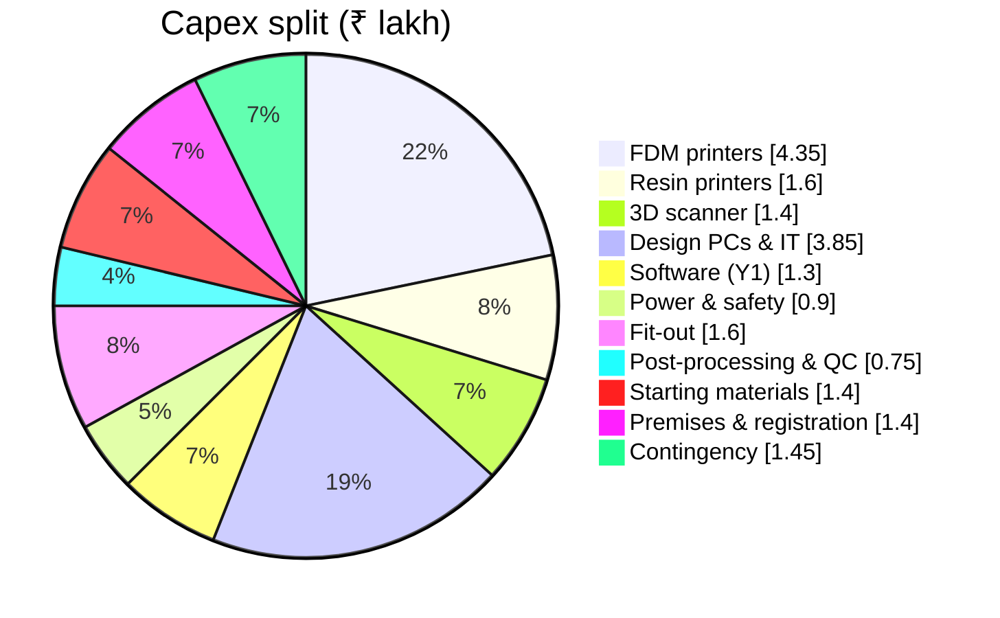
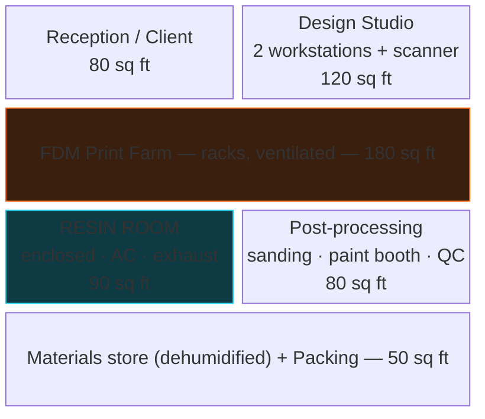
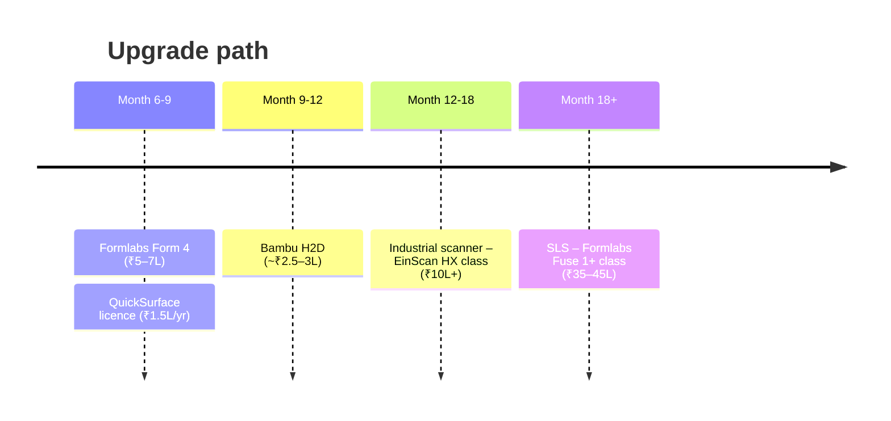

# 01 · The ₹20 Lakh Workshop

> A complete 3D printing service bureau in Bangalore — prototyping, small-batch parts, reverse engineering, miniatures and display models.

[← Back to index](../README.md) · [Next: Pricing model →](02-pricing-model.md)

> [!NOTE]
> All prices are indicative landed costs in India **including 18% GST** (Oct 2026). Always take 2–3 GST-invoiced quotes. If GST-registered, you can reclaim roughly **₹2.5–3L** as Input Tax Credit.

---

## Budget at a glance

| # | Category | ₹ Lakh |
|:-:|---|--:|
| 1 | FDM printers (4) | **4.35** |
| 2 | Resin printers + wash/cure (3 + 2) | **1.60** |
| 3 | 3D scanner | **1.40** |
| 4 | Design PCs, NAS, networking | **3.85** |
| 5 | Software (year 1) | **1.30** |
| 6 | Power backup & fire safety | **0.90** |
| 7 | Fit-out & furniture | **1.60** |
| 8 | Post-processing & QC tools | **0.75** |
| 9 | Starting materials & spares | **1.40** |
| 10 | Premises deposit & registrations | **1.40** |
| | **Subtotal** | **18.55** |
| | Contingency (~7%) | 1.45 |
| | **Total** | **20.00** |

---

## 1 · FDM printers — ₹4.35L

| Qty | Model | Role | Unit | Total |
|:-:|---|---|--:|--:|
| 1 | **Bambu Lab X1 Carbon Combo** (or current H2-series) | Engineering materials (CF-nylon, ASA, PC), multi-colour, best precision | 1.70 | 1.70 |
| 2 | **Bambu Lab P1S Combo** (or P2S successor) | Production workhorses — PLA, PETG, ABS, multi-colour | 0.95 | 1.90 |
| 1 | **Creality K1 Max** (300 mm³) | Large parts, enclosures, cosplay, architecture | 0.75 | 0.75 |

> [!TIP]
> All four are enclosed CoreXY machines — one technician can run them, and Bambu's farm manager lets you queue and monitor from one screen. Expected capacity: **~1,700 machine-hours/month** at 60% utilisation.

## 2 · Resin (MSLA) printers — ₹1.60L

| Qty | Model | Role | Unit | Total |
|:-:|---|---|--:|--:|
| 2 | **Elegoo Saturn 4 Ultra 16K** | Miniatures, product models, dental & jewellery masters | 0.48 | 0.96 |
| 1 | **Elegoo Mars 5 Ultra** | Small, high-detail jobs, test prints | 0.22 | 0.22 |
| 2 | **Wash & cure stations** (Mercury Plus / Anycubic W&C 3 Plus) | Post-processing | 0.21 | 0.42 |

**Upgrade path (month 6–12):** Formlabs Form 4 (~₹5–7L package) for certified dental/medical resins and industrial-grade clients.

## 3 · 3D scanner — ₹1.40L

| Qty | Model | Role | Cost |
|:-:|---|---|--:|
| 1 | **Revopoint MetroX** (Advanced) — blue laser + structured light | Reverse engineering, spare parts; ~0.02–0.04 mm accuracy | 1.35 |
| — | Scanning spray, markers, turntable | Consumables | 0.05 |

Budget alternative: Creality CR-Scan Raptor (~₹1.0L). Industrial upgrade: Shining3D EinScan HX (~₹10L+).

## 4 · Design PCs & IT — ₹3.85L

| Qty | Item | Spec | Cost |
|:-:|---|---|--:|
| 1 | **Workstation A** — scan, CAD, render | Ryzen 9 9900X / i7-14700, 64 GB DDR5, RTX 5070 Ti / 4070 Super 16 GB, 2 TB NVMe, 27" 4K | 1.75 |
| 1 | **Workstation B** — CAD, slicing | Ryzen 7 9700X, 32 GB, RTX 5060 Ti 16 GB, 1 TB NVMe, 27" QHD | 1.15 |
| 1 | Ops / front-desk mini PC + monitor | Queue, billing, client meetings | 0.35 |
| 1 | NAS (Synology DS224+ with 2 × 4 TB) | Project & scan backup | 0.40 |
| 1 | 3Dconnexion SpaceMouse | CAD productivity | 0.12 |
| — | Wi-Fi 6 router, switch, cabling | Printer network | 0.08 |

> [!IMPORTANT]
> Scan processing is RAM- and GPU-hungry. Don't cut Workstation A below 64 GB.

## 5 · Software (year 1) — ₹1.30L

| Software | Purpose | ₹/yr |
|---|---|--:|
| **Autodesk Fusion** (commercial, 2 seats) | Parametric CAD, CAM, simulation | 1.10 |
| Lychee Slicer Pro / Chitubox Pro | Resin slicing & supports | 0.10 |
| Zoho Books / Office suite | Billing, GST, quotes | 0.10 |
| Bambu Studio, OrcaSlicer, Creality Print | FDM slicing | Free |
| Revo Scan / Revo Studio | Scan processing (bundled) | Free |
| Blender, Meshmixer, FreeCAD | Sculpting, mesh repair, backup CAD | Free |

Later: QuickSurface (scan-to-CAD, ~₹1.5L/yr), ZBrush (~₹35k/yr).

---

## Space — ~600 sq ft

**Where:** Peenya, Bommasandra, Electronic City or Whitefield EPIP. Rent ~₹35–45/sq ft → **~₹24k/month**.

### Fit-out — ₹1.60L

| Item | ₹ Lakh |
|---|--:|
| Electrical: dedicated 16A circuits, RCCB, earthing | 0.35 |
| Resin room: aluminium + glass partition | 0.30 |
| 1.5T inverter split AC (resin likes 22–28 °C) | 0.45 |
| Exhaust fan + ducting + activated-carbon purifier | 0.15 |
| Steel work benches, printer racks | 0.25 |
| Desks, chairs, client table | 0.10 |

### Power & safety — ₹0.90L

| Item | ₹ Lakh |
|---|--:|
| 5 kVA inverter/UPS + batteries (BESCOM cuts kill 20-hr prints) | 0.70 |
| Surge protection / stabiliser | 0.10 |
| CO₂ + ABC extinguishers, smoke detectors, first aid | 0.10 |

### Premises — ₹1.40L

| Item | ₹ Lakh |
|---|--:|
| Security deposit (negotiated to 5 months; landlords often ask 6–10) | 1.20 |
| GST, Udyam, Shops & Establishments, basic website/branding | 0.20 |

---

## Post-processing & QC — ₹0.75L

| Item | ₹ Lakh |
|---|--:|
| Spray booth + airbrush + compressor | 0.15 |
| Dehumidifier (monsoon 70–80% RH ruins filament) | 0.15 |
| 2 × filament dryers | 0.12 |
| Mitutoyo digital caliper + micrometer | 0.10 |
| Ultrasonic cleaner | 0.08 |
| Dremel kit | 0.08 |
| PPE (3M respirators, nitrile gloves, goggles), heat gun, hand tools | 0.07 |

## Starting materials — ₹1.40L

| Item | ₹ Lakh |
|---|--:|
| ~60 kg filament: PLA, PETG, ABS, ASA, TPU, some PA-CF / PETG-CF | 0.80 |
| ~12 L resin: standard, ABS-like, tough, water-washable, a little castable | 0.40 |
| Spares: hardened nozzles, build plates, FEP/ACF films, PTFE | 0.14 |
| IPA ~30 L | 0.06 |

---

## Team

| Role | Profile | ₹/month |
|---|---|--:|
| Founder — Ops & Sales | You | — |
| Design engineer (CAD, scanning, RE) | B.E. Mech, 1–3 yrs | 35,000–45,000 |
| Print technician (farm, maintenance, slicing) | Diploma / ITI | 20,000–25,000 |
| Finishing technician | Hands-on; part-time initially | 18,000–22,000 |
| Accountant / CA | Outsourced | 5,000–8,000 |
| **Total** | + ~12% PF/ESI | **₹80k–1.0L** |

---

## Phase 2 roadmap (months 6–18, funded from revenue)

[← Back to index](../README.md) · [Next: Pricing model →](02-pricing-model.md)
