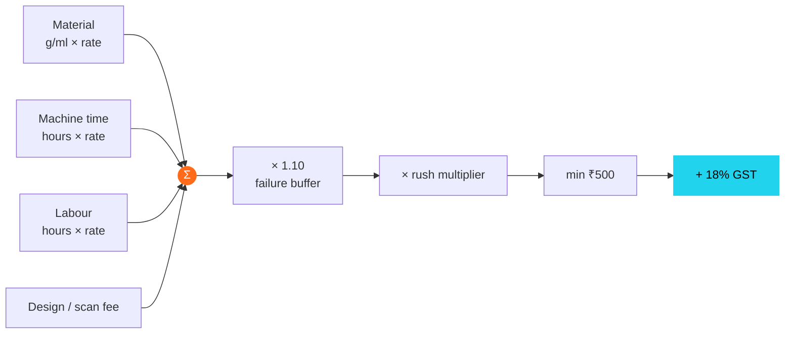

<p align="center"></p>

# 02 · Pricing Model

> Know your cost per machine-hour, mark up material, charge for labour — and never quote below ₹130–180 per FDM machine-hour all-in.

[← Workshop setup](01-workshop-setup.md) · [Index](../README.md) · [Next: Break-even →](03-break-even.md)

> [!TIP]
> Try the **live quote calculator** on the website: `docs/index.html` → *Pricing* section.

---

## A · What a machine-hour costs you

| Cost item | FDM (P1S / K1 Max) | FDM (H2S) | Resin (Saturn 4 Ultra) |
|---|--:|--:|--:|
| Depreciation (3 yrs, ~4,000 productive h/yr) | ₹6 | ₹13 | ₹5 |
| Maintenance & spares | ₹3 | ₹4 | ₹6 |
| Electricity (~₹10/unit) | ₹2 | ₹2.5 | ₹1 |
| **Machine cost / hour** | **~₹11** | **~₹19** | **~₹12** |

## B · Material — your cost vs. what you charge (2× markup)

| Material | Your cost | Charge |
|---|--:|--:|
| PLA / PETG | ₹1.2–1.3 / g | **₹2.5 / g** |
| ABS / ASA | ₹1.5 / g | **₹3 / g** |
| TPU | ₹2.5 / g | **₹5 / g** |
| PA-CF / PETG-CF | ₹4 / g | **₹8 / g** |
| Standard resin | ₹3 / ml | **₹6 / ml** |
| ABS-like / tough resin | ₹4.5 / ml | **₹9 / ml** |
| Castable resin | ~₹20 / ml | **₹40 / ml** |

## C · The quote formula



```
Price = (Material × rate) + (Print hours × machine rate) + (Labour hours × labour rate)
      + Design/scan fee
      × 1.10 (failure buffer) × rush multiplier
      → minimum ₹500, then add 18% GST
```

## D · Rate card

| Service | Rate |
|---|---|
| FDM machine time (P1S, K1 Max) | ₹60 / hr |
| FDM engineering (H2S — CF, nylon, PC) | ₹90 / hr |
| Resin machine time (per plate, split across parts) | ₹80 / hr |
| Technician (setup, support removal) | ₹400 / hr |
| Finishing (sanding, priming, painting) | ₹500 / hr |
| CAD design | ₹1,000–1,500 / hr · or ₹1,500–5,000 fixed for simple parts |
| 3D scanning (small–medium object) | ₹3,000–8,000 / object |
| Reverse engineering (scan → editable CAD) | ₹8,000–30,000 / part |
| Rush (24 h) | **+40%** |
| Volume | 10% off at 25+ units · 20% off at 100+ |

---

## E · Worked examples

<table>
<tr>
<td width="50%" valign="top">

### PETG bracket
150 g · 6 h on a P1S

| Line | ₹ |
|---|--:|
| Material 150 g × ₹2.5 | 375 |
| Machine 6 h × ₹60 | 360 |
| Labour 0.5 h × ₹400 | 200 |
| Failure buffer 10% | 94 |
| **Price (ex-GST)** | **1,029** |
| With GST | 1,214 |

Real cost ≈ ₹460 → **~55% gross margin**

</td>
<td width="50%" valign="top">

### Resin miniature
25 ml ABS-like · shares a plate with 5 parts

| Line | ₹ |
|---|--:|
| Material 25 ml × ₹9 | 225 |
| Machine share ~1 h × ₹80 | 80 |
| Wash, cure, supports 0.3 h × ₹500 | 150 |
| Failure buffer 10% | 46 |
| **Price (ex-GST)** | **~500** |

Retail miniatures in India: ₹500–1,500 → **competitive**

</td>
</tr>
</table>

> [!IMPORTANT]
> **Rule of thumb:** FDM should earn **₹130–180 per machine-hour** including material and labour. If a quote lands below that, raise the price or decline.

[← Workshop setup](01-workshop-setup.md) · [Index](../README.md) · [Next: Break-even →](03-break-even.md)
