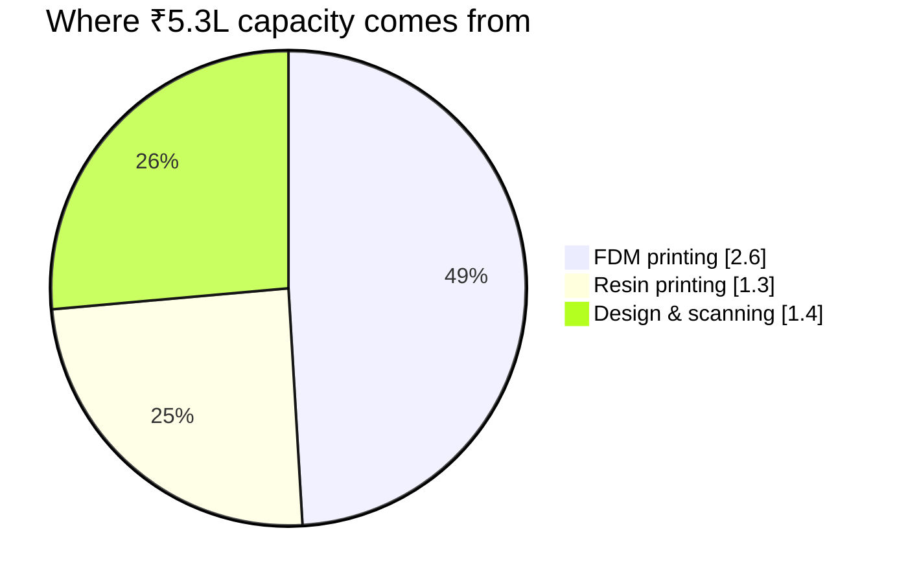
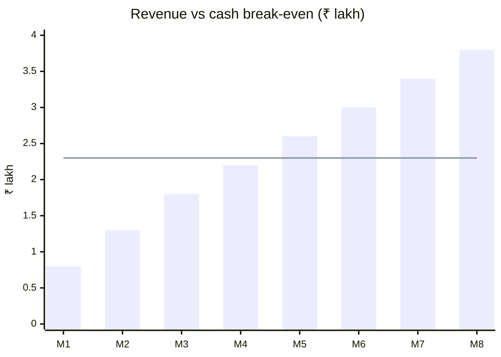

# 03 · Break-even Analysis

> Cash break-even at **~₹2.3L/month** — about **43% of capacity**. Operating losses recovered by **~month 8**.

[← Pricing model](02-pricing-model.md) · [Index](../README.md) · [Next: Suppliers →](04-suppliers.md)

---

## A · Monthly fixed costs

| Item | ₹ / month |
|---|--:|
| Salaries (3 staff + PF/ESI) | 1,03,000 |
| Rent (600 sq ft) | 24,000 |
| Software renewals (Fusion etc., monthly share) | 12,000 |
| Marketing (Google Ads, IndiaMART, Instagram) | 15,000 |
| Internet, maintenance, misc. | 6,000 |
| **Cash fixed costs** | **1,60,000** |
| Depreciation (₹11.2L equipment / 3 yrs — non-cash) | 31,000 |
| **Total incl. depreciation** | **1,91,000** |

**Variable costs ≈ 30% of revenue** (materials ~20%, electricity/consumables/packaging/payment fees ~10%) → **contribution margin ≈ 70%**.

## B · Break-even revenue

| Scenario | Monthly revenue needed (ex-GST) |
|---|--:|
| Cash break-even | **₹2.3 L** |
| After depreciation | **₹2.7 L** |
| With ₹50k founder salary | **₹3.4 L** |

## C · Capacity check

| Stream | Capacity | Revenue at capacity |
|---|---|--:|
| FDM | 4 × 720 h × 60% = 1,728 h @ ~₹150/h | ₹2.6 L |
| Resin | 3 × 720 h × 40% = 864 h @ ~₹150/h | ₹1.3 L |
| Design & scanning | 120 billable h × ₹1,200 | ₹1.4 L |
| **Realistic capacity** | | **~₹5.3 L / month** |

## D · One way to hit ₹2.3L/month

| Stream | Volume | Revenue |
|---|---|--:|
| B2B retainers (hardware startups, MSME jigs & fixtures) | 3 × ₹40,000 | ₹1.20 L |
| Retail / one-off orders | 50 × ₹1,500 | ₹0.75 L |
| Design & scan jobs | 8 × ₹5,000 | ₹0.40 L |
| **Total** | | **₹2.35 L** |

---

## E · First 8 months (projection)

| Month | Revenue | Cash profit / loss | Cumulative |
|:-:|--:|--:|--:|
| 1 | ₹0.8L | −₹1.04L | −₹1.04L |
| 2 | ₹1.3L | −₹0.69L | −₹1.73L |
| 3 | ₹1.8L | −₹0.34L | −₹2.07L |
| 4 | ₹2.2L | −₹0.06L | **−₹2.13L** ← lowest point |
| 5 | ₹2.6L | +₹0.22L | −₹1.91L |
| 6 | ₹3.0L | +₹0.50L | −₹1.41L |
| 7 | ₹3.4L | +₹0.78L | −₹0.63L |
| 8 | ₹3.8L | +₹1.06L | **+₹0.43L** |

> [!WARNING]
> Operating losses peak at **~₹2.1L**, more than the ₹1.45L contingency. Arrange **₹3–5L working capital** (Mudra / CGTMSE / overdraft) or hire the finishing technician only from month 4.

> [!NOTE]
> **Full capex payback ≈ 20–24 months.** At a steady ₹4.5L/month revenue you clear ~₹1.55L/month. GST input credit on equipment shortens this by ~2 months.

**Seasonality:** engineering-college project season (Feb–May) and Diwali corporate gifting (Sep–Nov) are peaks — build cash reserves then.

[← Pricing model](02-pricing-model.md) · [Index](../README.md) · [Next: Suppliers →](04-suppliers.md)
