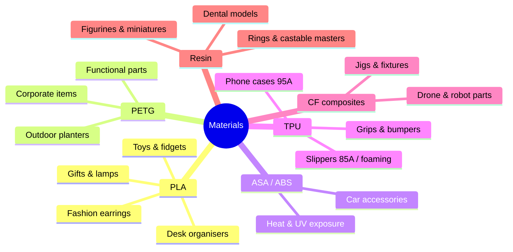
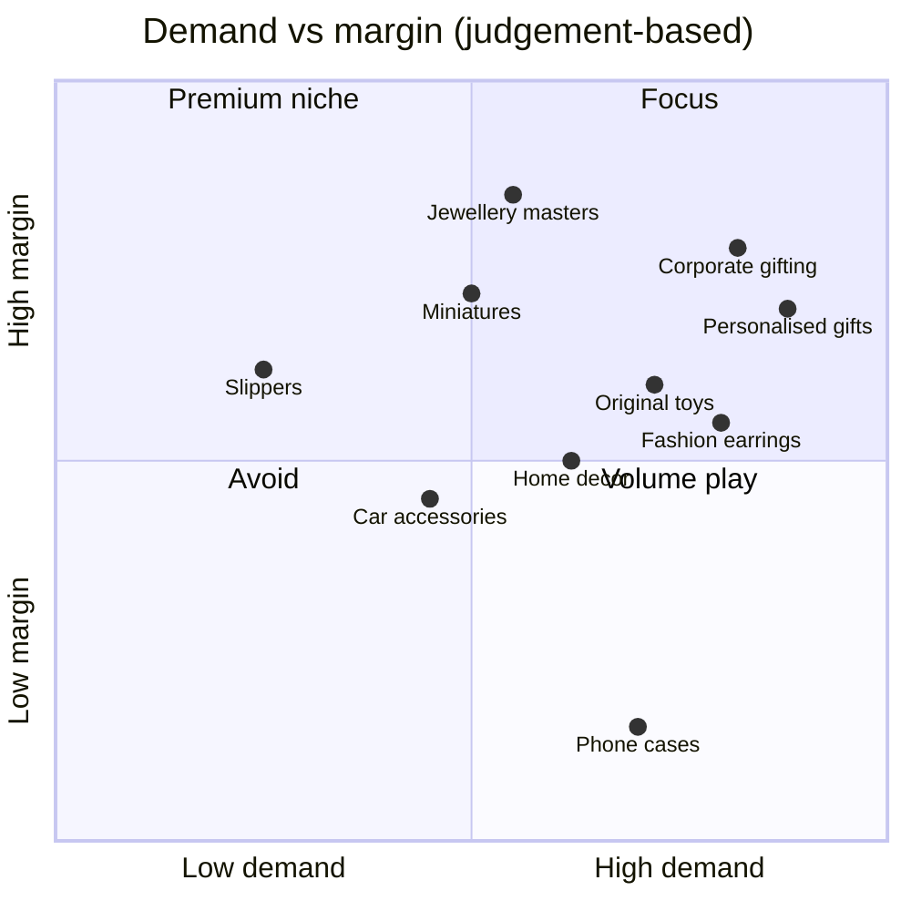

# 05 · Filaments, Products & Market Outlook

> Which material for which product — and what will sell in Bangalore and India over the next 2 years.

[← Suppliers](04-suppliers.md) · [Index](../README.md) · [Next: Slippers →](06-slippers.md)

---

## Material cheat-sheet

## Product → material → market

| Product | Best material | Machine | Material / piece | Typical price (India) | 2-yr outlook |
|---|---|---|--:|--:|:-:|
| **Personalised gifts** — name lamps, lithophanes, keychains | PLA matte / silk | FDM | ₹10–80 | ₹199–1,499 |  |
| **Corporate gifting** — desk organisers, pen stands, logo items | PLA / PETG | FDM | ₹40–150 | ₹399–1,500 (bulk) |  |
| **Fashion earrings & bangles** | PLA silk/matte, PETG; resin for detail | FDM / Resin | ₹5–30 | ₹199–799 |  |
| **Rings** | Tough resin; **castable resin** for gold/silver | Resin | ₹10–60 | ₹199–599 · B2B masters |  |
| **Original toys** — flexi animals, fidgets, dragons | PLA multi-colour | FDM | ₹20–150 | ₹199–999 |  |
| **Figurines & miniatures** | ABS-like resin | Resin | ₹30–200 | ₹500–3,000 painted |  |
| **Home décor, planters, lamps** | PLA; PETG outdoors | FDM | ₹50–300 | ₹299–2,000 |  |
| **Car accessories** | **ASA / PETG** (PLA warps in a hot car) | FDM | ₹30–200 | ₹299–1,500 |  |
| **Phone cases** | TPU 95A; PETG/PC hard | FDM | ₹20–50 | Amazon ₹99–299 |  |
| **Slippers / sandals** | TPU 85A / foaming TPU | FDM | ₹1,200–3,000+ / pair | Needs ₹2,500–4,000 |  |
| **Superhero toys** | — | — | — | — |  |

> [!CAUTION]
> **Superhero / licensed characters:** Marvel, DC, Disney and Indian characters like Chhota Bheem are copyrighted and trademarked. Unlicensed sales risk takedowns, marketplace bans and legal notices. Sell **original characters**, generic mythology, or custom *"mini-me"* figurines from customer photos.

---

## Tiered market view — Bangalore & India

| Tier | Categories | Action |
|:-:|---|---|
| **1** | Corporate gifting · personalised gifts · B2B prototyping, jigs & fixtures · jewellery castable masters · lightweight fashion jewellery | **Focus here** |
| **2** | Original toys & fidgets · painted miniatures · home décor · cosplay · festival items (Ganesh Chaturthi, Diwali) | Good add-ons |
| **3** | Slippers · phone cases · licensed characters | Niche or risky |

### The macro picture

| Source | Figure |
|---|---|
| MarketsandMarkets | India 3D printing **$276M (2025) → $763M (2030)**, ~22.5% CAGR |
| IMARC | **South India ≈ 34.8% share**; Bengaluru called India's *AM capital*; FDM leads technology share (35.2%) |
| NCAM report | ~20% CAGR to 2030; vat photopolymerisation (resin) growing fast in dental & jewellery |

Most growth is industrial — so **lead with B2B** and treat consumer products as a second engine.

> [!TIP]
> **Validate before you scale:** list 10–15 test designs on Instagram, Meesho and Amazon for 4–6 weeks; double down on whatever actually sells. The tiers above are professional judgement, not hard category data.

[← Suppliers](04-suppliers.md) · [Index](../README.md) · [Next: Slippers →](06-slippers.md)
