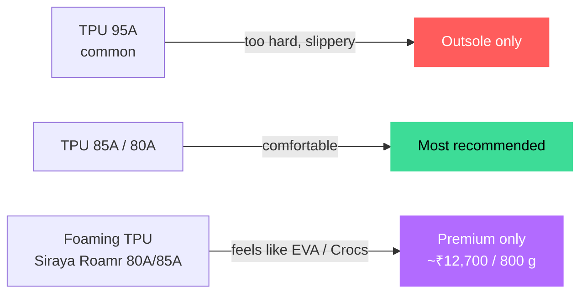

# 06 · Can We Print Soft Slippers?

> **Yes — but as a premium niche, not a mass product.**

[← Filaments & products](05-filaments-and-products.md) · [Index](../README.md) · [Next: Printers & waste →](07-printers-and-waste.md)

---

## Choosing the material

| Hardness | Feel | Use |
|---|---|---|
| **95A** | Stiff, "slappy", easy to print | Outsoles, durable sandal shells |
| **85A – 80A** | Genuine comfort, rubber-like; needs direct drive | Daily slides, midsoles |
| **Foaming 80A / 85A** | Squishy, high rebound, ~50% lighter | Recovery slides, premium custom pairs |

## Print recipe

| Setting | Value |
|---|---|
| Sole walls | **2** |
| Sole infill | **20% gyroid** (15% too soft, 25% too stiff — tested by designers) |
| Bottom texture | **Fuzzy skin** for grip |
| Upper | No walls, open infill → breathable (solid TPU traps sweat) |
| Drying | **55 °C for 4+ hours** — wet TPU splits |
| Feeding | **Directly into the extruder**, not through the AMS / long PTFE tubes |
| Speed (soft TPU) | Slow — 20–30 mm/s |

## The economics

| Item | Figure |
|---|--:|
| Filament per pair | 500–900 g |
| Print time per pair | 15–30 h (≈ 1 pair / printer / day) |
| Material cost / pair (standard soft TPU) | ₹1,200–3,000 |
| Price you must charge | **₹2,500–4,000** |
| Regular EVA slipper | ₹150–400 |

## Where slippers can win

- **Custom-fit** pairs from a foot scan (use the MetroX scanner)
- **Kids' fun designs**
- **Gifts & fashion statements**

> [!WARNING]
> Don't make medical or orthotic claims unless you partner with a podiatrist. Start with **5 test pairs** before committing.

[← Filaments & products](05-filaments-and-products.md) · [Index](../README.md) · [Next: Printers & waste →](07-printers-and-waste.md)
