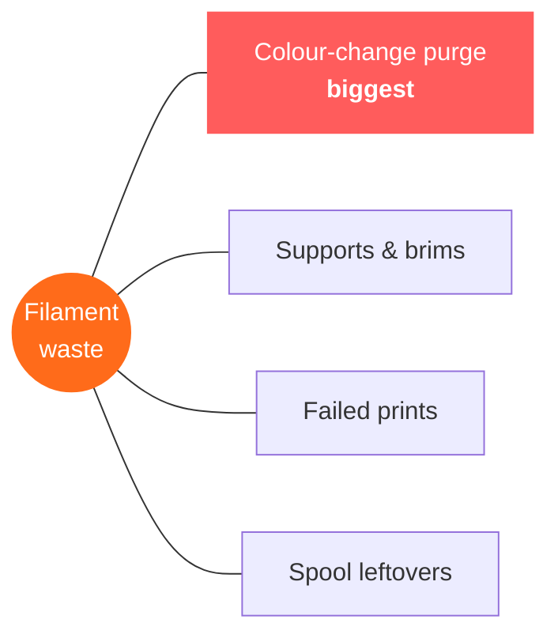
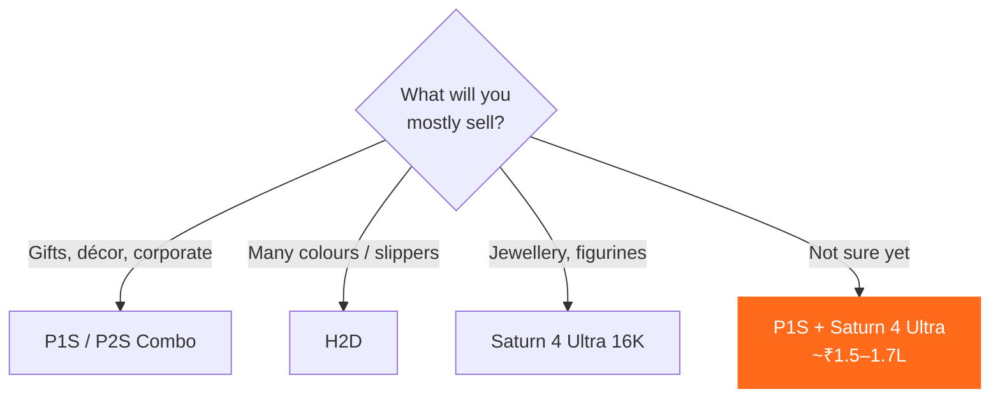

# 07 · Printers, Waste & Where to Start

> Purge on colour changes is the biggest source of filament waste. Pick the machine that matches how colourful your products are.

[← Slippers](06-slippers.md) · [Index](../README.md) · [Next: Software & AI →](08-software-and-ai.md)

---

## Where waste comes from

## Waste ranking

| Rank | Printer type | Waste | Why |
|:-:|---|---|---|
| 1 | **Bambu Lab H2C** — up to 7 swappable nozzles |  | Bambu's tests: **~47–58% of the X1C's purge waste** |
| 2 | **Bambu Lab H2D** — 2 independent nozzles |  | Model + support on separate nozzles → no purge; PLA + PVA prints that waste 20–40 g on an X1C waste almost nothing |
| 3 | **Resin printers** (Saturn 4 Ultra) |  | Only supports & failures; leftover resin goes back in the bottle |
| 4 | Single-nozzle FDM (P1S / X1C) — **one colour** |  | Mostly supports & failures |
| 5 | Single-nozzle FDM + **AMS, many colours** |  | 1–2 g+ per colour change; can exceed the model's own weight |

### Cut waste on any printer

- Fill each plate with several items so they **share one purge tower**
- Use **tree supports**
- Bambu Studio: enable **flush into infill** and **flush into objects**
- **Limit colours** per design
- **Dry filament** — wet filament = failed prints

> [!TIP]
> Mostly multi-colour products (toys, keychains, décor)? The **H2D / H2C** pays for itself in saved filament. Mostly single-colour? A **P1S / P2S** is perfect.

---

## Which printer to start with?

| Your focus | Start with | Why |
|---|---|---|
| General business — gifts, décor, corporate, toys | **Bambu Lab P1S / P2S Combo** | Reliable, easy, multi-colour, handles TPU when fed directly |
| Heavy multi-colour, low waste, slippers | **Bambu Lab H2D** | Big volume, dual nozzle, heated chamber |
| Rings, jewellery, figurines | **Elegoo Saturn 4 Ultra 16K** + wash & cure | Fine detail on a budget |
| **Best starter combo** | **1 × P1S/P2S Combo + 1 × Saturn 4 Ultra** | Covers ~90% of products for **~₹1.5–1.7L** |

[← Slippers](06-slippers.md) · [Index](../README.md) · [Next: Software & AI →](08-software-and-ai.md)
