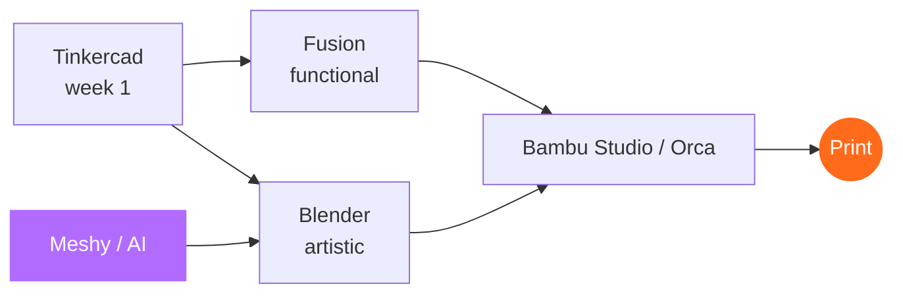

# 08 · Design Software & AI

> Tinkercad to learn, Fusion for function, Blender for art — and AI for figurines.

[← Printers & waste](07-printers-and-waste.md) · [Index](../README.md) · [Next: Industry →](09-industry.md)

---

## Software stack

| Purpose | Software | Cost |
|---|---|---|
| **Learn the basics** (week 1) | **Tinkercad** | Free, browser |
| **Functional items** — organisers, cases, car parts, slipper bases | **Autodesk Fusion** (top pick) | Free personal; ~₹55k/yr commercial |
| | Onshape | Free if designs are public |
| | FreeCAD | Free |
| **Artistic** — toys, figurines, sculpted jewellery | **Blender** (top pick) | Free |
| | Nomad Sculpt (iPad) | ~₹1,500 one-time |
| | ZBrush | ~₹35k/yr |
| **Professional jewellery** | **Rhino** + RhinoGold / MatrixGold | Industry standard; expensive |
| **Slicing** | Bambu Studio, OrcaSlicer, Lychee (resin) | Free / low cost |

> [!WARNING]
> Many free models on MakerWorld, Printables and Thingiverse are **non-commercial**. Check each model's licence before selling prints of it.

---

## Can AI do the design?

**Yes for artistic items. Not reliably for precise functional parts.**

| AI tool type | Examples | Good for | Not good for |
|---|---|---|---|
| **Text / photo → 3D** | **Meshy** (print-ready STL/3MF, printability check, auto-repair, send to Bambu Studio), Tripo, Hunyuan3D | Figurines, toys, décor, characters, *mini-me* from a photo | Millimetre-accurate fits (phone cases, slippers, brackets) |
| **AI-written design code** | ChatGPT / Claude writing **OpenSCAD** | Parametric organisers, name plates, boxes, trays | Organic shapes |
| **AI inside CAD** | Fusion generative design, Zoo Text-to-CAD | Lightweight engineering parts | Beginners |

### Business idea — *Photo → Figurine*

Perfect for weddings, birthdays and corporate awards.

> [!CAUTION]
> 1. **Commercial rights** — free AI plans often forbid commercial use; paid plans usually allow it. Check terms.
> 2. **Copyright still applies** — an AI-generated "Spider-Man" is still infringement.
> 3. **Expect clean-up** — fix thin walls and fragile parts; check scale before printing.

[← Printers & waste](07-printers-and-waste.md) · [Index](../README.md) · [Next: Industry →](09-industry.md)
