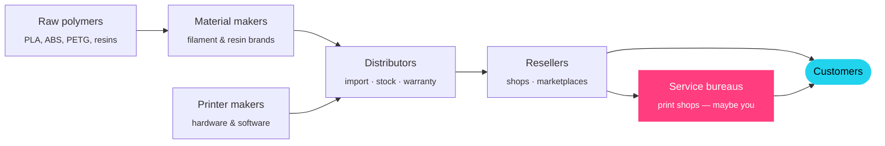
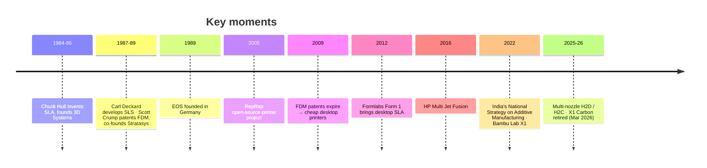
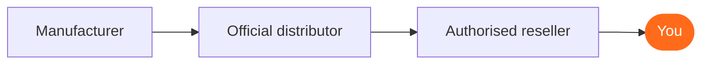

# 09 · The 3D Printing Industry

> Who makes what, who sells it in India, what it costs, whether to import, how people earn from it, and the careers it creates.

[← Software & AI](08-software-and-ai.md) · [Index](../README.md) · [Learn the basics →](00-learn-basics.md)

> [!TIP]
> The **interactive version** (sortable printer table with side-by-side compare, filament brand filter, value-chain explorer and **import cost calculator**) lives on the website → **Industry**.

> [!NOTE]
> Prices are from Indian reseller listings, **October 2026, including GST** unless stated. They change often and vary 5–10% between sellers. Margins and salaries are indicative estimates for learning.

---

## 1 · The value chain

| Stage | Global players | In India | How they make money |
|---|---|---|---|
| **Raw polymers** | NatureWorks, TotalEnergies Corbion (PLA); petrochemical & specialty-chemical majors | Mostly imported pellets; local compounders | Commodity volumes, thin margins |
| **Material makers** | Bambu, Polymaker, eSUN, SUNLU, Elegoo, Prusament, Siraya Tech | Numakers, FibReel, Vektor3D, 3dprintzkart, Ultra Nanotech | Extrusion + branding; premium charges 1.5–2× generic |
| **Printer makers** | Bambu, Creality, Elegoo, Anycubic, Prusa · Formlabs, UltiMaker · Stratasys, 3D Systems, EOS, HP | Divide By Zero, Fracktal Works, Make3D | Hardware + consumables, spares, software |
| **Distributors** | Regional master distributors | WOL3D, Protomont, Phillips, Corengg | Trading margin + AMC/training (~10–25% indicative) |
| **Resellers** | Brand stores, Amazon | Robu.in, KSP Electronics, 3Ding, 3D Protofarm, Ideal3D, Amazon.in | Thin margins; volume and accessories |
| **Service bureaus** | Protolabs, Xometry-type networks | Imaginarium, Think3D, Makenica, local shops | Machine time + design + finishing (~40–60% gross on prints) |
| **Customers** | Aerospace, medical, dental, auto, consumer | Startups, MSMEs, colleges, jewellers, dental labs, architects, gifting | Pay for speed, customisation, low volume |

## 2 · Forty years of 3D printing

### Who's who

| Company | From | Segment | Known for |
|---|---|---|---|
| Stratasys | USA / Israel | Industrial | FDM inventor; PolyJet |
| 3D Systems | USA | Industrial | SLA inventor; SLS, metal |
| EOS | Germany | Industrial | Laser sintering, polymer & metal |
| HP | USA | Industrial | Multi Jet Fusion nylon |
| Formlabs | USA | Professional | Desktop SLA & SLS |
| UltiMaker | Netherlands / USA | Professional | Ultimaker + MakerBot (merged 2022) |
| Prusa Research | Czechia | Prosumer | Open-source FDM |
| Bambu Lab | China | Consumer–pro | Fast CoreXY, AMS multi-colour |
| Creality | China | Consumer | Mass-market Ender / K-series |
| Elegoo · Anycubic | China | Consumer | Budget resin & FDM |
| Divide By Zero · Fracktal · Make3D | India | Industrial | Made-in-India FDM |

---

## 3 · Printer prices in India

| Brand | Model | Type | Price (India) | Build (mm) | Best for |
|---|---|---|--:|---|---|
| Bambu Lab | A1 Mini | FDM | ₹21,499 | 180³ | First printer |
| Bambu Lab | A1 | FDM | ₹31,999 | 256³ | Best-value beginner |
| Bambu Lab | A1 Mini Combo | FDM | ₹38,499 | 180³ | Multi-colour on a budget |
| Bambu Lab | A1 Combo | FDM | ₹48,999 | 256³ | Multi-colour beginner |
| Bambu Lab | A2L | FDM | ₹48,999 | Large format | Big parts on a budget |
| Bambu Lab | P1S | FDM, enclosed | ₹52,499 | 256³ | ABS / ASA |
| Bambu Lab | P1S Combo | FDM, enclosed | ₹69,999 | 256³ | Small-business workhorse |
| Bambu Lab | P2S | FDM, enclosed | ₹71,999 | 256³ | Newer, faster P1S |
| Bambu Lab | P2S Combo | FDM, enclosed | ₹1,02,999 | 256³ | Production multi-colour |
| Bambu Lab | H2S | FDM, heated chamber | ₹1,54,999 | ~350 class | Engineering materials |
| Bambu Lab | H2D | FDM, dual nozzle | from ₹2,19,999 | 350 × 320 × 325 | Multi-material, laser option |
| Bambu Lab | H2C Combo | FDM, multi-nozzle | ₹3,09,999 | ~350 class | Lowest-waste multi-colour |
| Creality | K1 Max | FDM, enclosed | ₹71,999 | 300³ | Large prints |
| Prusa | CORE One+ kit | FDM, enclosed | ₹1,35,000 | 250 × 220 × 270 | Build-it-yourself |
| Prusa | CORE One (assembled) | FDM, enclosed | ₹1.70–2.10L | 250 × 220 × 270 | Open-source, repairable |
| Elegoo | Saturn 4 Ultra 16K | Resin | ₹59,999–61,499 | Mid-size MSLA | Miniatures, jewellery |
| Formlabs | Form 4 | Professional resin | ~₹6.25L + GST | 200 × 125 × 210 | Dental, industrial |
| Divide By Zero / Fracktal / Make3D | Industrial ranges | FDM / resin | On request | Varies | Made in India |

> [!IMPORTANT]
> The **Bambu Lab X1 Carbon was discontinued on 31 March 2026**. Its successor, the X2D (US$649), had no Indian listing at the time of writing.

---

## 4 · Filament brands & where to buy

| Tier | Typical ₹ / kg | Verdict |
|---|--:|---|
| **Premium** | 1,300–2,500 | Most consistent; best through the AMS |
| **Mid · Chinese brands** | 1,000–1,400 | Best value for production |
| **Indian-made** | 700–1,300 | Cheapest; test before bulk |
| **Specialty** | 3,000–16,000 | Footwear, industrial, exotic |

| Brand | From | Tier | Price seen | Where |
|---|---|---|---|---|
| Bambu Lab | China | Premium | PLA/PETG ~₹1,300–2,500 · PETG-CF ₹4,799 · TPU 90A ₹3,299 | WOL3D, Robu.in |
| Polymaker | China | Premium | PolyLite PETG ₹1,299 | Protomont, Amazon.in |
| Prusament | Czechia | Premium | Import pricing | Prusa resellers |
| eSUN | China | Mid | PLA+ ₹1,300–1,349 | Voxelstudio, Ideal3D, Amazon.in |
| SUNLU | China | Mid | ~₹1,000–1,800 | Mechblock, Amazon.in |
| Elegoo | China | Mid | ~₹1,000–1,500 | WOL3D, Amazon.in |
| Numakers | India · Surat | Indian | Value tier | india.numakers.com · +91 95587 37223 |
| FibReel (Rever) | India · Nashik | Indian | Value tier | 3dprintingfilament.in |
| Vektor3D | India · Mumbai | Indian | PLA ₹1,300 · PETG ₹1,200 · TPU ₹2,500 | IndiaMART |
| 3dprintzkart | India · Bengaluru | Indian | PLA ~₹1,208 | dial4trade |
| Ultra Nanotech | India · Bengaluru | Indian | Call | ultrananotec.com |
| Siraya Tech | USA brand | Specialty | Roamr 80A ~₹12,717 / 800 g | Amazon.in |
| Francis Klein | India · Bengaluru | Specialty | Quote | franciskleinadditive.com |

**Getting the best price with good quality**
1. Everyday PLA/PETG → eSUN / SUNLU from Indian distributors, or Numakers.
2. AMS colours & engineering → Bambu or Polymaker.
3. Buy 10–20 kg, ask 10–15% off · watch Amazon sales · 3 kg spools for top colours · always compare **₹ per kg**.

---

## 5 · Who sells what in India

| Brand | Authorised channels |
|---|---|
| Bambu Lab | WOL3D (official), Robu.in, KSP Electronics, Ideal3D, Hydrotech 3D — full list at bambulab.com/en-in/where-to-buy |
| Creality | WOL3D (exclusive), Robu.in |
| Elegoo | WOL3D, Protomont, Voxelstudio, 3Ding, 3D Protofarm, Scribbl3D |
| Prusa | 3D Bazaar, Technoventor, Robu.in (kits) |
| Formlabs | Corengg, Phillips Machine Tools, Jetayu Gadgets · india@formlabs.com |
| Revopoint | Protomont, 3D Bazaar, RA Global Tech |
| Indian makers | Direct — divbyz.com, fracktal.in, make3d.in |

---

## 6 · Should you import filament from China?

| | Personal parcel | Commercial, 100 kg by air | Commercial, 500 kg+ by sea |
|---|---|---|---|
| Duty | ~35% BCD + surcharge + 28% IGST ≈ **77%** (not claimable) | HS 3916: 10% BCD + 1% AIDC + 1.1% SWS ≈ **12.1%**, plus 18% IGST (**claimable**) | Same |
| Freight (est.) | Courier | ~₹250–400 / kg | ~₹30–60 / kg |
| Landed PLA at $9/kg, ₹88/$ (est.) | ~₹2,000+ / kg | **~₹1,270–1,420 / kg** | **~₹940–970 / kg** |
| vs India (ex-GST ~₹1,100 for eSUN; less for Indian makers) | Much worse | Worse | About equal |
| Needs | Courier KYC | IEC + GST + customs agent | IEC + GST + customs agent |

> [!WARNING]
> AliExpress has been blocked in India since 2020, and the ₹5,000 gift exemption was scrapped in 2019. Imports add MOQ, 4–8 weeks' lead time, no warranty and batch-quality risk.

**Verdict:** buy Chinese brands from **Indian distributors** (near-import prices, GST invoice, local stock) and **Indian makers** for value PLA. Import only for unavailable materials, 200+ kg/month farms, or if you plan to become a distributor.

---

## 7 · Business models

| Model | What | Start (indicative) | Upside | Watch out |
|---|---|---|---|---|
| Service bureau | Print on demand for many clients | ₹10–25L | Steady B2B, repeat clients | Many small jobs, sales effort |
| Print farm & D2C | Your own products online | ₹3–15L | Scales, own brand | Marketing, copycats |
| B2B engineering | Jigs, fixtures, end-use parts | ₹10–30L | High value, sticky | Needs engineering skill |
| Education & training | Labs, workshops, courses | ₹2–10L | Recurring, grant-friendly | Seasonal |
| Reselling / distribution | Printers, filament, spares | ₹10L+ working capital | Volume, consumables | Thin margins, inventory |
| Design & digital files | Freelance CAD, sell STLs | ₹1–3L | No inventory | Low prices, competition |

## 8 · Careers (India, indicative)

| Role | Background | Pay |
|---|---|--:|
| Print technician / operator | ITI / diploma | ₹15–25k / month |
| CAD / design engineer | B.E. Mechanical | ₹3–6 LPA |
| 3D artist / sculptor | Blender, ZBrush portfolio | ₹3–8 LPA |
| Scanning & reverse-engineering specialist | Mech + metrology | ₹4–8 LPA |
| Application / sales engineer | Distributors & OEMs | ₹5–12 LPA |
| Additive manufacturing engineer | Industrial / metal AM | ₹5–12 LPA |
| Founder / print-shop owner | All of the above | Variable |

[← Software & AI](08-software-and-ai.md) · [Index](../README.md) · [Learn the basics →](00-learn-basics.md)
